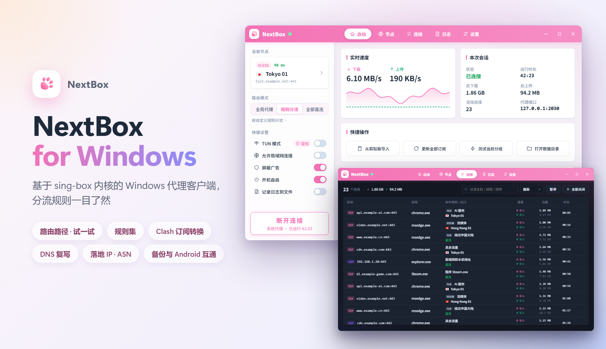

<p align="center">
  
</p>

<h1 align="center">NextBox</h1>

<p align="center">
  基于 sing-box 内核的 Windows 代理客户端
</p>

<p align="center">
  <a href="https://github.com/Efah-Dev/NextBox/releases/latest"></a>
  <a href="https://github.com/Efah-Dev/NextBox/releases"></a>
  <a href="https://github.com/Efah-Dev/NextBox/actions/workflows/build.yml"></a>
  
  
  <a href="https://t.me/nextboxofficial"></a>
  <a href="LICENSE"></a>
</p>

<p align="center">
  <b>简体中文</b> · <a href="README_EN.md">English</a> · <a href="https://nextbox.efah.dev/">官网</a> · <a href="https://t.me/nextboxofficial">Telegram 频道</a> · <a href="https://github.com/Efah-Dev/NextBox/releases/latest">下载</a> · <a href="https://github.com/Efah-Dev/NextBox-Android">Android 版</a>
</p>

<p align="center">
  
</p>

NextBox 是 [sing-box](https://github.com/SagerNet/sing-box) 的 Windows 图形客户端，从已经停更的
[NekoBox for PC（nekoray）](https://github.com/MatsuriDayo/nekoray) 发展而来，界面全部重做。
分流规则按顺序排成一条路径，每个连接走到哪一步、为什么，都能直接看到。
规则和备份与 [NextBox for Android](https://github.com/Efah-Dev/NextBox-Android) 通用。

> NextBox 是独立项目，与 SagerNet / sing-box 以及 MatsuriDayo / nekoray 没有隶属或背书关系。

## 2.5.0 更新

**新增**

- 托盘菜单重新设计：按订阅选节点、选分组代理，每个订阅可以直接测延迟；选完菜单不关，跟随深色模式
- 全局快捷键：连接、系统代理、TUN、路由模式、显示主界面、测延迟，默认不设置
- 粘贴或拖进窗口即可导入，自动分辨订阅、节点链接、Clash / sing-box 配置和备份文件
- 节点页网格视图，右键节点打开操作菜单
- 下载测速，时长和流量上限可以自己设
- 直接用分组代理连接，流量仍按实际节点统计；自动分组可以单独设测试间隔

**改进**

- 「测速」改为「测延迟」，新安装默认 URL 测试
- 设置页一次显示一个分区，说明更短，细节放在问号里
- 提示统一从右下角弹出，界面加入过渡动画
- 新建分组代理默认手动挑选，列表显示协议和服务器
- 内核升级到 sing-box 1.14.5

完整记录见 [Releases](https://github.com/Efah-Dev/NextBox/releases)。

## 功能

**分流**

- 路由路径：屏蔽广告、常用场景、规则和规则集按顺序排列，拖动即可调整
- 「试一试」：输入一个网址，路径上标出它在哪一步被接住
- 规则集：把域名、IP、程序、网站分类、IP 归属地和网上的规则集归到一起，统一指定去向
- 绕过中国大陆：内置国内规则，默认经代理解析，不怕 DNS 污染
- 分组代理：按地区、关键词或手动挑选，自动选最快或手动指定

**订阅与节点**

- 支持 Base64、Clash、sing-box 格式的订阅；Clash 订阅的分组、规则和 DNS 可以一起转换，随订阅更新
- 支持 Shadowsocks、VMess、VLESS（Reality）、Trojan、Hysteria2、TUIC、AnyTLS、NaiveProxy 等协议，以及链式代理
- 延迟测试和下载测速；节点前显示国旗，可以按国家搜索
- 订阅自带的专属 DNS 只用于它自己的节点

**连接**

- 系统代理和 TUN；装上服务模式后，开 TUN 不再需要管理员身份
- 同一分组内切换节点不断开已有连接
- 启动页显示落地 IP、国家和所属网络（ASN）
- 连接页列出每个连接命中的规则和出口节点，右键就能把它加入规则

**其他**

- 密码加密的备份，和 Android 版互相导入
- 浅色 / 深色主题、自定义主题色；简体中文、繁體中文、English

所有功能和常见问题见 [功能与常见问题](FEATURES.md)。

## 下载安装

在 [Releases](https://github.com/Efah-Dev/NextBox/releases/latest) 下载 `NextBox-v<版本>-windows-amd64.zip`。
需要 64 位 Windows 10 / 11 和 WebView2 运行时（Windows 11 自带）。

1. 解压到一个有写入权限的文件夹，比如 `D:\Apps\NextBox`。NextBox 是便携版，数据就放在程序旁边，所以别放进 `C:\Program Files`。
2. 运行 `NextBox.exe`。程序没有代码签名，SmartScreen 拦下时点「更多信息 → 仍要运行」。
3. 升级时覆盖旧文件，保留 `config` 文件夹。

## 上手

1. 在「节点」页添加订阅，或者复制分享链接后按 Ctrl+V。
2. 点一个节点选中它，可以先测一下延迟。
3. 回到「启动」页点「连接」，系统代理会自动设置好。
4. 关掉窗口后 NextBox 留在托盘，右键图标可以快速切换；选「退出」才会真正关闭。

## 交流

- Telegram 频道：[t.me/nextboxofficial](https://t.me/nextboxofficial)，发布新版本和使用说明
- 遇到问题或有建议，请提 [Issue](https://github.com/Efah-Dev/NextBox/issues)

## sing-box 内核

发布包里的 `core/sing-box.exe` 由官方 sing-box 1.14.5 源码编译，没有任何修改，只编入 NextBox 用到的功能，体积约为官方版的一半。
`libcronet.dll` 是 NaiveProxy 需要的网络库。NextBox 生成的是 sing-box 1.12 及以上的配置格式，也可以换成更新的官方内核，
详见 [功能与常见问题](FEATURES.md#sing-box-内核)。

## 从源码编译

需要 [Go](https://go.dev/dl/) 1.25+、[Node.js](https://nodejs.org/) LTS 和 Wails CLI：

```bash
git clone https://github.com/Efah-Dev/NextBox.git
cd NextBox
go install github.com/wailsapp/wails/v2/cmd/wails@latest
wails build                                                              # build/bin/NextBox.exe
powershell -ExecutionPolicy Bypass -File scripts/build-core.ps1          # 内核，读取 ../sing-box-stable 的源码
powershell -ExecutionPolicy Bypass -File scripts/build-service.ps1       # 服务模式用的 NextBoxService.exe
go test ./...
```

开发时用 `wails dev` 热重载。每次推送和 Pull Request 都会在 GitHub Actions 上测试并编译。

<details>
<summary>目录结构</summary>

```
main.go                  程序入口：启动参数，嵌入界面文件
cmd/genicon/             生成应用图标
cmd/nextbox-service/     NextBoxService.exe（服务模式）
internal/
  app/       窗口、托盘、快捷键和界面调用的接口；版本号在 version.go
  clash/     Clash 订阅的分组、规则、DNS 转换，订阅专属 DNS 识别
  config/    生成 sing-box 1.12+ 配置
  store/     数据模型与 JSON 持久化
  link/      分享链接解析 / 导出，订阅格式解析
  sub/       订阅下载
  core/      内核进程、Clash API 客户端、延迟测试与下载测速
  geo/       落地 IP 与 ASN、IP 数据库、根据节点名称推测地区
  vault/     备份与本地数据加密（AES-256-GCM，与 Android 版相同）
  service/   NextBox 服务：命名管道协议、以系统权限运行内核
  sys/       系统代理、管理员权限、开机自启、全局快捷键、任务栏
  update/ i18n/ icon/ logfile/ ruleset/
frontend/src/            界面（Vue 3）
third_party/systray/     修改过的托盘库
scripts/                 编译内核与服务；sync-android.ps1 把共用代码同步到 Android 版
docs/render/             README 主页图的源文件
```

`docs/preview.png` 是真实界面配上模拟数据，用无头 Chrome / Edge 渲染：先在 `frontend` 里 `npm run build`，再运行 `node docs/render/render.mjs`。

</details>

## 致谢

- [MatsuriDayo/nekoray](https://github.com/MatsuriDayo/nekoray)：NextBox 的原项目
- [SagerNet/sing-box](https://github.com/SagerNet/sing-box)：代理内核；[sing-geosite](https://github.com/SagerNet/sing-geosite)、[sing-geoip](https://github.com/SagerNet/sing-geoip)：规则集
- [Wails](https://wails.io)、[Vue](https://vuejs.org)、[fyne systray](https://github.com/fyne-io/systray)、[go-winio](https://github.com/microsoft/go-winio)、[思源黑体](https://github.com/notofonts/noto-cjk)、[Simple Icons](https://github.com/simple-icons/simple-icons)
- 由 Claude（Anthropic）协助开发

各组件的许可证见 [THIRD_PARTY_NOTICES.md](THIRD_PARTY_NOTICES.md)。

## 许可证

[GPL-3.0-or-later](LICENSE)。请在遵守所在国家或地区法律法规的前提下使用。
