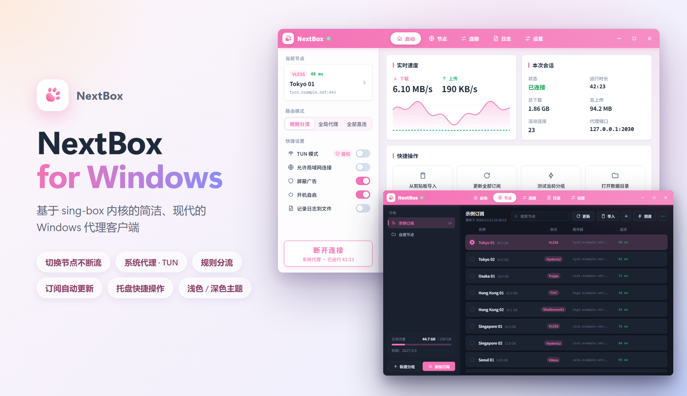

<p align="center">
  
</p>

<h1 align="center">NextBox</h1>

<p align="center">
  基于 sing-box 内核的简洁、现代的 Windows 代理客户端
</p>

<p align="center">
  <a href="https://github.com/Efah-Dev/NextBox/releases/latest"></a>
  <a href="https://github.com/Efah-Dev/NextBox/releases"></a>
  <a href="https://github.com/Efah-Dev/NextBox/actions/workflows/build.yml"></a>
  
  
  
  
  <a href="LICENSE"></a>
</p>

<p align="center">
  <b>简体中文</b> · <a href="README_EN.md">English</a> · <a href="https://github.com/Efah-Dev/NextBox/releases/latest">下载</a> · <a href="https://github.com/Efah-Dev/NextBox-Android">Android 版</a>
</p>

<p align="center">
  
</p>

NextBox 是 [sing-box](https://github.com/SagerNet/sing-box) 代理内核的桌面图形客户端。它延续了已停更的
[NekoBox for PC（nekoray）](https://github.com/MatsuriDayo/nekoray) 的功能，重新设计了启动器风格的界面，
采用 sing-box 最新的配置格式，并加入了系统托盘。

> NextBox 是独立项目，与 SagerNet / sing-box 以及 MatsuriDayo / nekoray **没有任何隶属或背书关系**。

## ✨ 功能

- 🔌 **协议**：Shadowsocks、VMess、VLESS（含 Reality / Vision）、Trojan、Hysteria2、TUIC、AnyTLS、SOCKS、HTTP
- 📡 **订阅**：Base64 链接列表、Clash / Clash.Meta YAML、sing-box JSON；显示已用流量和到期时间；可按设定的间隔自动更新
- 🗂️ **节点**：表单编辑常用字段，或直接编辑完整的 sing-box 出站 JSON；搜索、排序、批量删除；导出分享链接
- 🔀 **切换节点不断流**：同一分组的节点一次载入内核，切换时不重启内核，已建立的连接（例如正在进行的下载）不会中断
- ⚡ **测速**：URL 测试（与 NekoBox 相同：先建立连接，再测往返时间）和 TCP 测试；可配置测试地址、超时、并发数
- 🧭 **路由**：规则分流（绕过中国大陆）/ 全局代理 / 全部直连；可视化规则编辑（网站分类、域名、IP、程序名）；屏蔽广告
- 🖥️ **系统代理**：连接时自动设置，包括宽带拨号（PPPoE）和系统 VPN 连接；断开、退出、内核崩溃以及 Windows 注销 / 关机时自动还原
- 🛡️ **TUN 模式**：接管全部流量（需要管理员权限，可一键「以管理员身份重启」）
- 🌍 **DNS**：远程 DNS 走代理，直连 DNS 走本地；支持 UDP / TCP / DoT / DoQ / DoH / DoH3
- 📌 **托盘**：关闭窗口后常驻托盘；右键菜单可启动 / 关闭代理、切换节点、路由模式和 TUN。绿点 = 系统代理，红点 = TUN
- 📜 **连接与日志**：实时连接列表（目标、进程、规则、速度）；日志筛选；可选记录日志文件（单文件大小上限、保留天数）
- 🔄 **更新**：在「设置 → 关于」里检查 NextBox 和 sing-box 内核的新版本，与 GitHub Releases 比对；也可以打开「自动检查更新」（默认关闭）。只提醒，不会自动下载
- 🎨 **外观**：浅色 / 深色 / 跟随系统，自定义主题色（默认淡粉色），思源黑体 Noto Sans SC
- 🌐 **语言**：简体中文、繁體中文、English

## 📦 下载

在 [Releases](https://github.com/Efah-Dev/NextBox/releases/latest) 页面下载 `NextBox-<版本>-windows-amd64.zip`。

**系统要求**：Windows 10 / 11 64 位，需要 Microsoft Edge WebView2 运行时（Windows 11 和已更新的 Windows 10 自带）。

1. 把压缩包解压到一个有写入权限的文件夹，例如 `D:\Apps\NextBox`。
   **不要**放在 `C:\Program Files` 里：NextBox 是便携版，数据保存在程序旁边。
2. 运行 `NextBox.exe`。程序没有代码签名，第一次运行时 Windows SmartScreen 可能会拦截，
   点击「更多信息 → 仍要运行」即可。

> 切换节点不断流、订阅自动更新、检查更新、拨号连接的系统代理从 v1.1.0 开始提供。

## 🚀 快速上手

1. 「节点」页 →「添加订阅」（或复制分享链接后点「导入」）。
2. 点击选中一个节点，也可以先测速。
3. 「启动」页 → 点击「连接」，系统代理会自动设置。
4. 关闭窗口后 NextBox 会留在托盘里；右键猫爪图标可以快速操作，选「退出」才会真正关闭。

## 🧩 sing-box 内核

发布包里的 `core/sing-box.exe` 由官方源码**未经修改**编译而成：

| | |
|---|---|
| 版本 | **sing-box 1.14.4** |
| 分支 | **`stable` 稳定分支**（官方稳定版，标签 [`v1.14.4`](https://github.com/SagerNet/sing-box/tree/v1.14.4)） |
| 编译环境 | Go 1.27.3，`windows/amd64`，CGO 关闭 |
| 编译标签 | `with_gvisor, with_quic, with_dhcp, with_wireguard, with_utls, with_acme, with_clash_api, with_tailscale, with_ccm, with_ocm, with_cloudflared, with_usbip, with_openvpn, with_openconnect, badlinkname, tfogo_checklinkname0` |

以上与官方 Windows 发布版的编译标签一致，只去掉了需要额外 cronet DLL 的 `with_naive_outbound` / `with_purego`。
内核版本和编译标签也可以在「设置 → 关于」里查看。

NextBox 生成的是 sing-box **1.12 及以上**格式的配置，所以可以把 `core/` 里的 `sing-box.exe` 换成任何更新的官方版本。

## 💾 数据保存位置

所有数据都在 `NextBox.exe` 旁边（便携模式），迁移到另一台电脑时复制整个文件夹即可：

| 路径 | 内容 |
|---|---|
| `config/profiles.json` | 分组、订阅和节点 |
| `config/settings.json` | 设置 |
| `config/rule-set/` | 下载的 geosite / geoip 规则集 |
| `config/logs/` | 日志文件（仅在开启「记录日志到文件」时生成） |

## ❓ 常见问题

**TUN 模式打不开？** 需要管理员权限。在「启动」页或「设置 → TUN 模式」里点「以管理员身份重启」。

**切换节点会断网吗？** 连接时会把当前节点所在分组的节点（最多 200 个）一起载入内核，在它们之间切换不需要重启：
新连接走新节点，已建立的连接继续走原来的节点直到结束。切换到其他分组的节点、编辑过的节点，或者修改路由模式等设置时，
内核仍然需要重启。

**规则集需要下载吗？** 默认的「本地内置」镜像使用程序自带的规则集（绕过中国域名和中国 IP），无需联网。
其他规则集（如屏蔽广告、geosite:xxx）在第一次使用时下载；下载失败或超时只会在日志里报错，
连接照常进行，只是暂时跳过相关规则。可以在「设置 → 路由规则 → 规则集镜像」里换一个镜像后点「更新规则集」。

**订阅什么时候自动更新？** 在「设置 → 订阅与测速」里打开「自动更新订阅」并选择间隔。只在 NextBox 运行期间更新，
程序没有运行时不会更新。

**导入时有节点被跳过？** 导入提示和日志页会写明原因。XHTTP 传输、VLESS 加密等 Xray 专有功能 sing-box 不支持。

**「屏蔽广告」是什么？** 拦截社区维护的 `geosite-category-ads-all` 广告域名清单，连接和 DNS 查询都会拦截。
和正文使用同一个域名的广告（例如部分视频广告）无法拦截。

**检查更新失败？** 未连接时是直连 GitHub，网络不通就会失败；连接后再检查即可。

**2030 端口被占用？** 在「设置 → 入站」里修改混合代理（HTTP + SOCKS5）端口。

## 🛠️ 从源码编译

需要 [Go](https://go.dev/dl/) 1.25+、[Node.js](https://nodejs.org/) LTS，以及 Wails CLI：

```bash
git clone https://github.com/Efah-Dev/NextBox.git
cd NextBox
go install github.com/wailsapp/wails/v2/cmd/wails@latest
```

编译 `build/bin/NextBox.exe`：

```bash
wails build
```

编译 sing-box 内核（默认读取 `../sing-box-stable` 的源码，输出到 `build/bin/core/sing-box.exe`）：

```bash
powershell -ExecutionPolicy Bypass -File scripts/build-core.ps1
```

运行测试（需要先编译前端；配置校验、测速和节点切换的测试会用到上面编译的内核，没有内核时自动跳过）：

```bash
go test ./...
```

开发时可以用 `wails dev` 热重载。每次推送和 Pull Request 都会在 GitHub Actions 上跑测试并编译 `NextBox.exe`。

<details>
<summary>目录结构</summary>

```
main.go、app.go、support.go   Wails 入口与暴露给界面的接口
background.go                 订阅自动更新、检查更新
tray.go                       系统托盘
cmd/genicon/                  生成应用图标
internal/
  store/     数据模型与 JSON 持久化
  link/      分享链接解析 / 导出，订阅格式解析
  sub/       订阅下载
  config/    生成 sing-box 1.12+ 配置
  core/      内核进程、Clash API 客户端、测速
  update/    查询 GitHub 最新版本
  icon/      粉色猫爪图标绘制（应用图标与托盘）
  i18n/      后端翻译（与 frontend/src/i18n 共用词典）
  logfile/   日志文件（自动分割与过期清理）
  sys/       系统代理、管理员权限、开机自启（Windows）
frontend/src/
  views/        启动、节点、连接、日志、设置页面
  components/   标题栏、卡片、对话框、规则编辑器等
  i18n/         en.json（中文 → 英文）、zh-TW.json（简体 → 繁体）
scripts/build-core.ps1   从源码编译 sing-box
docs/render/             README 主页渲染图的源文件
```

</details>

<details>
<summary>图标与主页渲染图</summary>

应用图标（`build/appicon.png`、`build/windows/icon.ico`）和 `docs/logo.png` 已包含在源码中。
修改 `internal/icon` 后，用 `go run ./cmd/genicon` 重新生成。

`docs/preview.png` 和 `docs/preview-en.png` 是真实的前端界面加上模拟数据，用无头 Chrome / Edge 渲染出来的。
界面有变化后重新生成：

```bash
cd frontend && npm install && npm run build && cd ..
node docs/render/render.mjs
```

</details>

## 🗺️ 后续计划

- 链式代理、负载均衡 / 自动选择节点组
- 二维码导入导出、全局热键
- Linux / macOS 支持

## 🙏 致谢

- [MatsuriDayo/nekoray](https://github.com/MatsuriDayo/nekoray)：NextBox 的原项目
- [SagerNet/sing-box](https://github.com/SagerNet/sing-box)：代理内核
- [SagerNet/sing-geosite](https://github.com/SagerNet/sing-geosite)、[sing-geoip](https://github.com/SagerNet/sing-geoip)：规则集
- [Wails](https://wails.io)、[Vue](https://vuejs.org)、[fyne systray](https://github.com/fyne-io/systray)、[思源黑体 Noto Sans SC](https://github.com/notofonts/noto-cjk)
- 由 Claude（Anthropic）协助开发

各组件的许可证见 [THIRD_PARTY_NOTICES.md](THIRD_PARTY_NOTICES.md)。

## 📄 许可证

[GPL-3.0-or-later](LICENSE)。

请在遵守您所在国家或地区法律法规的前提下使用本软件。
