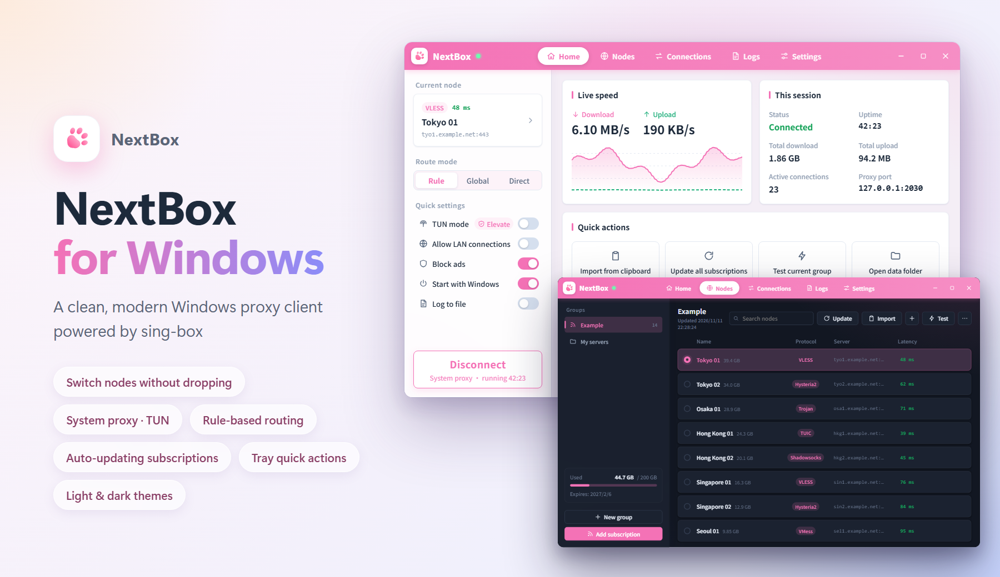

<p align="center">
  
</p>

<h1 align="center">NextBox</h1>

<p align="center">
  A clean, modern Windows proxy client powered by sing-box
</p>

<p align="center">
  <a href="https://github.com/Efah-Dev/NextBox/releases/latest"></a>
  <a href="https://github.com/Efah-Dev/NextBox/releases"></a>
  <a href="https://github.com/Efah-Dev/NextBox/actions/workflows/build.yml"></a>
  
  
  
  
  <a href="LICENSE"></a>
</p>

<p align="center">
  <a href="README.md">简体中文</a> · <b>English</b> · <a href="https://nextbox.efah.dev/">Website</a> · <a href="https://github.com/Efah-Dev/NextBox/releases/latest">Download</a> · <a href="https://github.com/Efah-Dev/NextBox-Android">Android</a>
</p>

<p align="center">
  
</p>

NextBox is a desktop GUI for the [sing-box](https://github.com/SagerNet/sing-box) proxy core. It continues
the feature set of the no-longer-maintained [NekoBox for PC (nekoray)](https://github.com/MatsuriDayo/nekoray)
with a rewritten launcher-style interface, the current sing-box configuration format, and a system tray.

> NextBox is an independent project. It is **not affiliated with or endorsed by** SagerNet / sing-box
> or MatsuriDayo / nekoray.

## ✨ Features

- 🔌 **Protocols**: Shadowsocks, VMess, VLESS (incl. Reality / Vision), Trojan, Hysteria2, TUIC, AnyTLS, SOCKS, HTTP
- 📡 **Subscriptions**: Base64 link lists, Clash / Clash.Meta YAML, sing-box JSON; shows used traffic and expiry date; optional automatic updates at an interval you choose
- 🗂️ **Nodes**: form editor for common fields, or edit the full sing-box outbound JSON; drag to reorder; search, sort, bulk delete; export share links
- 🚩 **Flags and country search**: a flag in front of every node, by exit IP by default (checked during URL tests) or by server IP; searching "Hong Kong" or "香港" finds HK, 🇭🇰 and Hong Kong nodes alike
- ⛓️ **Chain proxies**: send traffic through 2 to 8 nodes in a row, e.g. an airport node as the entry and your own VPS as the exit; members come from any group, can be reordered by dragging, and the whole chain can be tested before saving
- 🔀 **Switch nodes without dropping connections**: the nodes of a group are loaded into the core together, so switching does not restart it and open connections (a running download, for example) are not cut
- ⚡ **Latency test**: URL test (round trip on an established connection, same method as NekoBox) and TCP test; a bolt button on every node tests just that node; protocols over UDP (Hysteria2, TUIC …) and chain proxies always use a URL test; configurable URL, timeout and concurrency
- 🧭 **Routing**: global (the default, nothing to set up) / rule-based (bypasses mainland China by default) / direct. Rule-based mode adds scenario switches (AI services, streaming, game downloads direct …) and your own rules, checked in order (site categories, domains, IPs, programs), each sending traffic to the current node, direct, blocked or a policy group; drag to reorder or edit as text; the *Rule tester* shows which rule an address matches and where it goes
- 🧩 **Policy groups**: group nodes by region, name keywords or by hand, use the fastest automatically or pick one, and send different sites through different groups (YouTube via Japan, Google via the US); groups by region or keyword pick up new nodes after subscription updates
- 🚫 **Ad blocking**: works in every routing mode
- 📍 **Exit info**: once connected, the home page shows the node's flag, exit IP (masked by default) and a status light, checked again regularly
- 🖥️ **System proxy**: set automatically on connect, including dial-up (PPPoE) and Windows VPN connections; restored on disconnect, exit and core crash; cleared first thing at Windows logoff / shutdown, and cleared at the next logon if NextBox was killed before it could
- 🚀 **Autostart**: Settings shows whether Windows will really start NextBox; a disabled entry, a moved program and similar problems are explained with a one-click fix; with TUN mode NextBox starts through a scheduled task as administrator; optionally connects to the last node after starting with Windows
- 🛡️ **TUN mode**: captures all traffic (requires administrator; one-click "Restart as administrator"); optional FakeIP with an editable exclusion list
- 💾 **Backup & encryption**: export / import nodes and subscriptions, routing rules and other settings separately, encrypted with a password (AES-256, the same format as the Android version); the node list on disk can be encrypted too (tied to your Windows account, or with a start-up password); the core configuration is no longer written to disk
- 🌍 **DNS**: remote DNS through the proxy, direct DNS locally; UDP / TCP / DoT / DoQ / DoH / DoH3
- 📌 **Tray**: keeps running in the tray after closing the window; start / stop, switch node, route mode and TUN from the menu. Green dot = system proxy, red dot = TUN
- 📜 **Connections & logs**: live connection list (target, process, rule, speed); log viewer with filters; optional log files with size limit and retention
- 🔄 **Updates**: check for new versions of NextBox and the sing-box core in Settings → About, compared with GitHub Releases; optional automatic check (off by default). It only notifies, nothing is downloaded
- 🎨 **Look & feel**: light / dark / follow system; adjustable brightness of the light theme and depth of the dark theme (down to black); preset accent colors or a color panel (pink by default); Noto Sans SC font
- 🌐 **Languages**: 简体中文, 繁體中文, English

## 📦 Download

Get `NextBox-<version>-windows-amd64.zip` from the [Releases](https://github.com/Efah-Dev/NextBox/releases/latest) page.

**Requirements**: Windows 10 / 11, 64-bit, with Microsoft Edge WebView2 Runtime (preinstalled on Windows 11
and on up-to-date Windows 10).

1. Extract the zip to a folder you can write to, e.g. `D:\Apps\NextBox`.
   Do **not** use `C:\Program Files`: NextBox is portable and stores its data next to the program.
2. Run `NextBox.exe`. The release is not code-signed, so Windows SmartScreen may warn on first launch;
   choose *More info → Run anyway*.

> Switching nodes without dropping connections, automatic subscription updates, the update check and the
> system proxy for dial-up connections are available from v1.1.0 on; chain proxies, drag to reorder and
> flags with country search from v1.2.0 on; policy groups, the new routing rules, backup & encryption, FakeIP
> and the autostart check from v2.0.0 on.

## 🚀 Quick start

1. **Nodes** → *Add subscription* (or copy share links and click *Import*).
2. Click a node to select it, or run a latency test first.
3. **Home** → click **Connect**. The system proxy is set automatically.
4. Closing the window keeps NextBox in the tray; right-click the paw icon for quick actions, or choose *Exit*.

## 🧩 sing-box core

The release package ships `core/sing-box.exe`, built from **unmodified** official source:

| | |
|---|---|
| Version | **sing-box 1.14.4** |
| Branch | **`stable`** (official stable release, tag [`v1.14.4`](https://github.com/SagerNet/sing-box/tree/v1.14.4)) |
| Built with | Go 1.27.3, `windows/amd64`, CGO disabled |
| Build tags | `with_gvisor, with_quic, with_dhcp, with_wireguard, with_utls, with_acme, with_clash_api, with_tailscale, with_ccm, with_ocm, with_cloudflared, with_usbip, with_openvpn, with_openconnect, badlinkname, tfogo_checklinkname0` |

These are the official Windows release tags, except `with_naive_outbound` / `with_purego`, which need an
extra cronet DLL. The core version and tags are also shown in **Settings → About**.

NextBox generates configurations in the sing-box **1.12+** format, so you can replace the core with any
newer official release by dropping another `sing-box.exe` into `core/`.

## 💾 Where data is stored

Everything lives next to `NextBox.exe` (portable); to move NextBox to another PC, copy the whole folder:

| Path | Contents |
|---|---|
| `config/profiles.json` | Groups, subscriptions, nodes and policy groups (optionally encrypted) |
| `config/settings.json` | Settings |
| `config/rule-set/` | Downloaded geosite / geoip rule-sets |
| `config/logs/` | Log files (only when *Log to file* is enabled) |
| `config/cache/` | Temporary files of latency tests, emptied afterwards |

With *Encrypt nodes and subscriptions* set to *Tied to your Windows account*, `profiles.json` only opens under
this Windows account on this PC. Export a backup in Settings → Data & backup before moving to another PC.

## ❓ FAQ

**TUN mode can't be turned on.** It needs administrator rights. Use *Restart as administrator* (Home page
or Settings → TUN).

**Does switching nodes interrupt the network?** On connect, the nodes of the current node's group (up to 200)
are loaded into the core together, and switching between them needs no restart: new connections use the new
node, connections that are already open stay on the old one until they end. Switching to a node of another
group or to an edited node, or changing settings such as the route mode, still restarts the core.

**Do rule-sets need a download?** The default *Local built-in* mirror uses the rule-sets shipped inside
the program (bypass China domains and China IPs), so no network is needed. Other rule-sets (ad blocking,
geosite:xxx) are downloaded on first use; a failure or timeout is only reported in the log, the connection
still starts and just skips those rules. To retry, pick a mirror in Settings → Routing rules → *Rule-set mirror*
and click *Update rule-sets*.

**How are the flags decided?** Choose in Settings → Subscriptions & tests → *Node location*. *Exit IP* asks
Cloudflare once through the node during a URL test and shows what websites see, the most accurate option.
*Server IP* looks the server up in the sing-geoip database (a 4 MB download on first use) without going through
the node, but relayed nodes then show where their entry is. Until a node is checked, the flag is guessed from
its name (hover the flag to see why).

**How do I use a chain proxy?** Nodes → the *+* button in the toolbar → *New chain proxy*, then add nodes and
put them in order: the first is the entry, the last the exit. Chain proxies live in manual groups. When a member
is deleted, or renamed by a subscription update, the chain is marked broken and the editor lets you replace
that hop.

**Does a subscription update undo my order?** A manual *Update* asks first and then restores the order of the
subscription; background updates keep your order and append new nodes.

**When are subscriptions updated automatically?** Turn on *Update subscriptions automatically* in
Settings → Subscriptions & tests and pick an interval. Updates only happen while NextBox is running.

**A node is skipped on import.** The import message and the Logs page say why. Xray-only features such as
the XHTTP transport and VLESS encryption are not supported by sing-box.

**What does "Block ads" do?** It blocks the domains in the community-maintained `geosite-category-ads-all`
list, for both connections and DNS. Ads served from the same domain as the content cannot be blocked.

**The update check fails.** While disconnected it reaches GitHub directly, which fails where GitHub is not
reachable; connect first and check again.

**Port 2030 is already in use.** Change the mixed (HTTP + SOCKS5) port in Settings → Proxy port.

**Global or rule-based?** Global sends all traffic through the current node; there is nothing to set up and
your own rules do not apply. Rule-based sends mainland China sites and IPs direct and the rest through the
proxy; turn on scenarios or add rules of your own on top.

**How do I send different sites through different nodes?** Create a group in Settings → Policy groups (e.g.
by region "Japan", fastest automatically), then add a rule in Settings → Routing rules → *My rules*, e.g. site
category YouTube → Japan auto. Policy groups only apply in rule-based mode.

**Can I use a backup on my phone?** A backup from Settings → Data & backup → *Export* imports directly in
NextBox for Android, and Android backups import here. A backup from another system brings its nodes, routing
rules and shared settings; ports, TUN and the like stay as they are.

**Which encryption should I pick?** *Tied to your Windows account* needs no password and autostart keeps
working, the right choice for most people. *Start-up password* asks for the password every time NextBox
opens (when started with Windows it waits on the unlock screen); a forgotten password cannot be recovered.

**Autostart does not work.** Settings → General → *Start with Windows* shows the result of a check. A
disabled entry, a moved program or TUN mode without administrator rights are explained; click the fix button.

**What is FakeIP?** TUN mode only: proxied domains first get a placeholder 198.18.x.x address, which makes
first connections faster and keeps DNS from leaking. After disconnecting, a few programs may keep the
placeholder and fail until restarted; domains with problems can be added to the exclusion list.

## 🛠️ Building from source

Requirements: [Go](https://go.dev/dl/) 1.25+, [Node.js](https://nodejs.org/) LTS, and the Wails CLI:

```bash
git clone https://github.com/Efah-Dev/NextBox.git
cd NextBox
go install github.com/wailsapp/wails/v2/cmd/wails@latest
```

Build `build/bin/NextBox.exe`:

```bash
wails build
```

Build the sing-box core (expects the sing-box source in `../sing-box-stable`, output goes to
`build/bin/core/sing-box.exe`):

```bash
powershell -ExecutionPolicy Bypass -File scripts/build-core.ps1
```

Run the tests (build the frontend first; the config, latency and node-switching tests use the core built
above and skip themselves without it):

```bash
go test ./...
```

For live development use `wails dev`. Every push and pull request is tested and built on GitHub Actions.

<details>
<summary>Project layout</summary>

```
main.go, app.go, support.go   Wails entry point and the API exposed to the UI
background.go                 Automatic subscription updates, update check
policy.go, backup.go          Policy groups and the rule tester, backups and encryption
exit.go, startup.go           Exit IP checks; autostart check, cleanup at shutdown
tray.go                       System tray
cmd/genicon/                  Generates the application icons
internal/
  store/     Data model and JSON persistence
  link/      Share-link parsing / export, subscription formats
  sub/       Subscription download
  config/    sing-box 1.12+ configuration builder
  core/      Core process, Clash API client, latency tests
  update/    Looks up the latest GitHub release
  geo/       Exit IP, IP database, guessing the region from node names
  vault/     Encryption of backups and local data (AES-256-GCM, same format as Android)
  icon/      Pink paw icon renderer (app + tray)
  i18n/      Backend translations (shares the dictionaries in frontend/src/i18n)
  logfile/   Log files with rotation and retention
  sys/       System proxy, elevation, autostart (Windows)
frontend/src/
  views/        Home, Nodes, Connections, Logs, Settings (settings/ holds the sections)
  components/   Title bar, cards, dialogs, rule editor, …
  i18n/         en.json (Chinese → English), zh-TW.json (Simplified → Traditional)
scripts/build-core.ps1   Builds sing-box from source
docs/render/             Source of the README hero images
```

</details>

<details>
<summary>Icons and hero images</summary>

The app icons (`build/appicon.png`, `build/windows/icon.ico`) and `docs/logo.png` are committed. After
changing `internal/icon`, regenerate them with `go run ./cmd/genicon`.

`docs/preview.png` and `docs/preview-en.png` are the real frontend running on made-up data, rendered with
headless Chrome / Edge. Regenerate them after UI changes:

```bash
cd frontend && npm install && npm run build && cd ..
node docs/render/render.mjs
```

</details>

## 🗺️ Roadmap

- Load-balancing / auto-select groups
- QR code import / export, global hotkeys
- Linux / macOS support

## 🙏 Credits

- [MatsuriDayo/nekoray](https://github.com/MatsuriDayo/nekoray): the project NextBox is based on
- [SagerNet/sing-box](https://github.com/SagerNet/sing-box): proxy core
- [SagerNet/sing-geosite](https://github.com/SagerNet/sing-geosite), [sing-geoip](https://github.com/SagerNet/sing-geoip): rule-sets
- [Wails](https://wails.io), [Vue](https://vuejs.org), [fyne systray](https://github.com/fyne-io/systray), [Noto Sans SC](https://github.com/notofonts/noto-cjk)
- Developed with the help of Claude (Anthropic)

See [THIRD_PARTY_NOTICES.md](THIRD_PARTY_NOTICES.md) for licenses.

## 📄 License

[GPL-3.0-or-later](LICENSE).

Use this software in accordance with the laws and regulations of your country or region.
