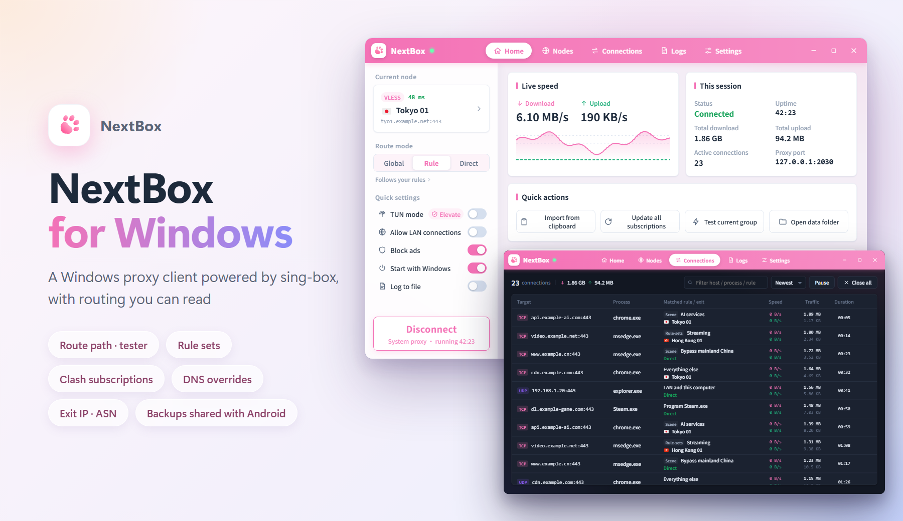

<p align="center">
  
</p>

<h1 align="center">NextBox</h1>

<p align="center">
  A Windows proxy client built on sing-box
</p>

<p align="center">
  <a href="https://github.com/Efah-Dev/NextBox/releases/latest"></a>
  <a href="https://github.com/Efah-Dev/NextBox/releases"></a>
  <a href="https://github.com/Efah-Dev/NextBox/actions/workflows/build.yml"></a>
  
  
  <a href="https://t.me/nextboxofficial"></a>
  <a href="LICENSE"></a>
</p>

<p align="center">
  <a href="README.md">简体中文</a> · <b>English</b> · <a href="https://nextbox.efah.dev/">Website</a> · <a href="https://t.me/nextboxofficial">Telegram channel</a> · <a href="https://github.com/Efah-Dev/NextBox/releases/latest">Download</a> · <a href="https://github.com/Efah-Dev/NextBox-Android">Android</a>
</p>

<p align="center">
  
</p>

NextBox is a Windows app for the [sing-box](https://github.com/SagerNet/sing-box) proxy core. It grew out of
[NekoBox for PC (nekoray)](https://github.com/MatsuriDayo/nekoray), which is no longer maintained, and has a new interface.
Routing rules are laid out as one ordered path, so you can see which step catches a connection and why.
Rules and backups work with [NextBox for Android](https://github.com/Efah-Dev/NextBox-Android) too.

> NextBox is an independent project, not affiliated with or endorsed by SagerNet / sing-box or MatsuriDayo / nekoray.

## What's new in 2.5.1

**New**

- Clash.Meta's gost-plugin (Shadowsocks) nodes, also as share links
- A Clash subscription's proxy-providers are downloaded when it updates
- Hysteria nodes from Clash subscriptions

**Improved**

- The tray menu shows the app icon at the top left
- Copying the share links of several nodes skips the ones that have none and copies the rest

**Fixed**

- When no nodes can be read from a Clash subscription, the error now says why
- Clash configs with a repeated key could not be imported

2.5.0 brought the redesigned tray menu, system-wide hotkeys, drag-and-drop import, the grid view, the download speed test and connecting through a policy group.

Every release is on the [Releases](https://github.com/Efah-Dev/NextBox/releases) page.

## Features

**Routing**

- The route path: ad blocking, common scenes, rules and rule sets in one order you can drag around
- "Try it": type a URL and the path shows the step that catches it
- Rule sets: domains, IPs, programs, site categories, IP regions and online rule sets grouped under one target
- Bypass mainland China: built-in rules, resolved through the proxy by default so DNS poisoning does not get in
- Policy groups by region, keyword or hand-picked, using the fastest node or a chosen one

**Subscriptions and nodes**

- Base64, Clash and sing-box subscriptions; a Clash subscription's groups, rules and DNS can come along and update with it
- Shadowsocks, VMess, VLESS (Reality), Trojan, Hysteria2, TUIC, AnyTLS, NaiveProxy and more, plus proxy chains
- Latency and download speed tests; flags in front of nodes, search by country
- A subscription's own DNS server is used for its nodes only

**Connecting**

- System proxy and TUN; with service mode installed, TUN no longer needs administrator rights
- Switching nodes within a group keeps open connections alive
- The home page shows the exit IP, country and network (ASN)
- The connections page shows the rule and exit node of every connection; right-click to turn it into a rule

**More**

- Password-protected backups that move between Windows and Android
- Light and dark themes, your own accent color; Simplified Chinese, Traditional Chinese, English

The full list and an FAQ are in [Features and FAQ](FEATURES_EN.md).

## Download

Get `NextBox-v<version>-windows-amd64.zip` from [Releases](https://github.com/Efah-Dev/NextBox/releases/latest).
You need 64-bit Windows 10 / 11 and the WebView2 runtime (built into Windows 11).

1. Extract it to a folder you can write to, such as `D:\Apps\NextBox`. NextBox is portable and keeps its data next to the program, so not `C:\Program Files`.
2. Run `NextBox.exe`. It is not code-signed: if SmartScreen stops it, choose *More info → Run anyway*.
3. To upgrade, replace the files and keep the `config` folder.

## Getting started

1. Add a subscription on the Nodes page, or copy a share link and press Ctrl+V.
2. Click a node to select it; you can test its latency first.
3. Go back to Home and click the connect button. The system proxy is set for you.
4. Closing the window leaves NextBox in the tray; right-click the icon for quick switches, and pick *Exit* to really close it.

## Community

- Telegram channel: [t.me/nextboxofficial](https://t.me/nextboxofficial), for new releases and how-tos
- Problems and ideas go to [Issues](https://github.com/Efah-Dev/NextBox/issues)

## sing-box core

`core/sing-box.exe` in the release is built from the official sing-box 1.14.5 source without changes, with only the features NextBox uses,
about half the size of the official build. `libcronet.dll` is the network library NaiveProxy needs. NextBox writes sing-box 1.12+ configs,
so a newer official core works too; see [Features and FAQ](FEATURES_EN.md#sing-box-core).

## Building from source

You need [Go](https://go.dev/dl/) 1.25+, [Node.js](https://nodejs.org/) LTS and the Wails CLI:

```bash
git clone https://github.com/Efah-Dev/NextBox.git
cd NextBox
go install github.com/wailsapp/wails/v2/cmd/wails@latest
wails build                                                              # build/bin/NextBox.exe
powershell -ExecutionPolicy Bypass -File scripts/build-core.ps1          # the core, from the source in ../sing-box-stable
powershell -ExecutionPolicy Bypass -File scripts/build-service.ps1       # NextBoxService.exe for service mode
go test ./...
```

Use `wails dev` for hot reload. Every push and pull request is tested and built on GitHub Actions.

<details>
<summary>Layout</summary>

```
main.go                  entry point: start arguments, embedded UI files
cmd/genicon/             generates the app icon
cmd/nextbox-service/     NextBoxService.exe (service mode)
internal/
  app/       window, tray, hotkeys and the API the UI calls; the version is in version.go
  clash/     Clash groups, rules and DNS conversion, subscription DNS
  config/    sing-box 1.12+ config generation
  store/     data model and JSON storage
  link/      share links in and out, subscription formats
  sub/       subscription downloads
  core/      core process, Clash API client, latency and speed tests
  geo/       exit IP and ASN, IP database, regions from node names
  vault/     backup and local data encryption (AES-256-GCM, same as Android)
  service/   the NextBox service: named pipe protocol, runs the core as SYSTEM
  sys/       system proxy, elevation, autostart, hotkeys, taskbar
  update/ i18n/ icon/ logfile/ ruleset/
frontend/src/            UI (Vue 3)
third_party/systray/     a modified tray library
scripts/                 core and service builds; sync-android.ps1 copies shared code to the Android app
docs/render/             source of the README images
```

`docs/preview.png` is the real UI with sample data, rendered with headless Chrome / Edge: run `npm run build` in `frontend`, then `node docs/render/render.mjs`.

</details>

## Thanks

- [MatsuriDayo/nekoray](https://github.com/MatsuriDayo/nekoray), the project NextBox started from
- [SagerNet/sing-box](https://github.com/SagerNet/sing-box), the proxy core; [sing-geosite](https://github.com/SagerNet/sing-geosite) and [sing-geoip](https://github.com/SagerNet/sing-geoip), the rule sets
- [Wails](https://wails.io), [Vue](https://vuejs.org), [fyne systray](https://github.com/fyne-io/systray), [go-winio](https://github.com/microsoft/go-winio), [Noto Sans SC](https://github.com/notofonts/noto-cjk), [Simple Icons](https://github.com/simple-icons/simple-icons)
- Developed with help from Claude (Anthropic)

Licenses of all components are in [THIRD_PARTY_NOTICES.md](THIRD_PARTY_NOTICES.md).

## License

[GPL-3.0-or-later](LICENSE). Use it in line with the laws where you live.
